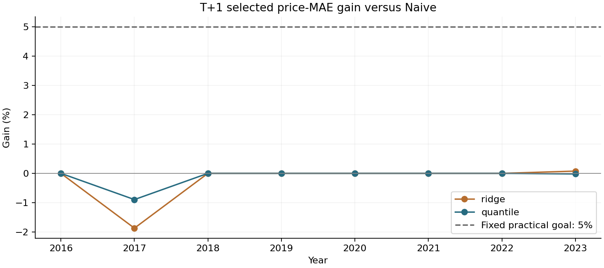
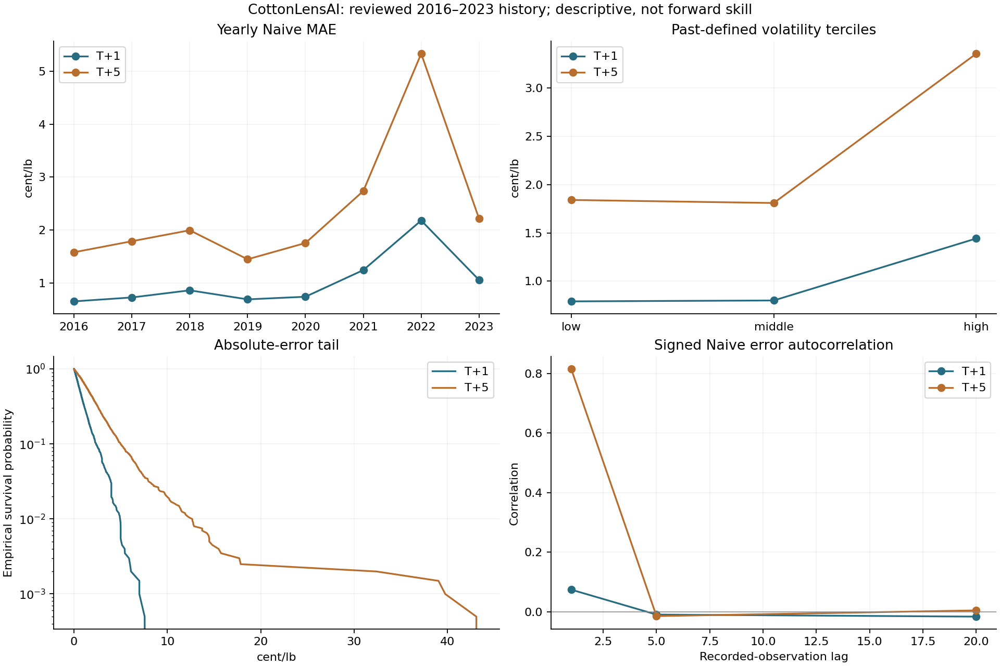

# Sabit fiyat-only koşullu medyan sonucu — 5 Kasım 2026

**Karar: STOP.** Ön kayıtlı T+1 Quantile tarifi Naive fiyat-MAE'sini geçmedi.
338 piyasa + 4 ayrı sentetik kontrol tamamlandı. Aynı 2016–2023 döneminde iki kol
2.006 origin kullandı; 16 yıllık çıktı ve 4.012 tahmin satırı korundu.
Yeni fit yapmadan native modeller, preprocessing/target state, geçmiş seçim ve
rapor doğrulandı. Ablation ve T+5 eğitimi açılmadı; Naive/EWMA referansları korunur.

## Sonuçlar

MAE birimi cent/lb; kazanç=100×(1−model_MAE/Naive_MAE).

| Model | MAE | Naive kazancı | Tüm-origin yön | Kazanılan yıl |
| --- | ---: | ---: | ---: | ---: |
| Naive | 1.020952 | 0% | — | — |
| Ridge seçilmiş | 1.022558 | −0.157292% | 12.46% | 1/8 |
| Quantile seçilmiş (birincil) | 1.021795 | **−0.082523%** | 11.67% | **0/8** |
| Ridge ham | 1.049295 | −2.776133% | 49.40% | 0/8 |
| Quantile ham | 1.022163 | −0.118619% | 48.21% | 3/8 |

İki seçilmiş kolun aktif oranı %24.7757; 2017 ve 2023 aktif, diğer 6 yıl geçmiş ağırlık0.
Düşük tüm-origin yön yüzdeleri flat tahminleri de içerir; aktif yön doğruluğu
olarak okunmamalıdır. Ham yön de %53 kapısının altında.

Birincil Quantile seçilmiş Naive kazancı için 10.000 tekrar / seed42 / yıl sınırları
korunan recentered moving-block %95 aralıkları:

| Blok | Kazanç aralığı |
| --- | --- |
|20|[−0.174660%; +0.015183%]|
|60|[−0.139934%; −0.023398%]|

İki üst sınır da %5'in çok altında. En büyük %1 Naive hatası çıkarılınca seçilmiş
Quantile kazancı −0.086614%, ham−0.120364%;uç gözlemleri çıkarmak tarifi kurtarmıyor.
Seçilmiş Quantile'ın Ridge'e nokta katkısı küçük;iki kontrol karşılaştırma aralığı
sıfırı içeriyor. Modellerin loss ve düzenlileştirmesi farklı olduğu için fark
tek başına loss etkisi sayılmadı. Sonuç, bu sabit tarihsel tarifin pratik hedefi
sağlamadığını gösterir; bütün modellerde sinyal yokluğu veya ileri dönem sonucu değildir.



## Üç araştırma sorusunun cevabı

1. **Neden Naive geçilemedi?** Denenen düzeltmelerde kararlı taşınan fiyat sinyali
   gösterilemedi. Eski ham tahminlerin genliği/hatası büyümüş; geçmiş küçültme çoğu
   yıl Naive'ye dönerek zararı azaltmış. Yanlış legacy karşılaştırma ve veri
   semantiği kusurları belgelenmiş olsa da aynı-origin/aynı-kontrat ve loss
   kontrolleri başarısızlığın tek bunlardan geldiğini göstermiyor. Bu deneyde ham
   Quantile da negatif; yalnız küçültmenin sinyali yok ettiği açıklaması desteklenmiyor.
2. **En güçlü yeni hipotez ne oldu?** Az fiyat özelliğiyle koşullu medyan hipotezi
   önceden seçildi ve şimdi test edildi. Ham Ridge'den daha düşük hata üretmesine
   rağmen Naive üstünlüğü sağlamadı. Bu sonucu yeni alpha/grid veya daha büyük
   model gerekçesi olarak kullanmak için kanıt yok.
3. **Sonraki kontrollü deney ve durma?** Onaylanan deney tamamlandı ve durma koşulu
   gerçekleşti. Bu tarif kapatılır; ablation/T+5/GPU genişlemesi yapılmaz. Yeni
   araştırma ancak eski sicilden somut farkı ve veri kabulü gösterilen ayrı bir
   hipotez/ön kayıtla açılır. Bu teslimatta başka piyasa fit'i onaylanmış sayılmaz.

## Denetim ve tekrar üretim

[Ön kayıt/audit](NAIVE_MAE_AUDIT_20261105.md):fiyat semantiği ve leakage sınırları,
665 yerel payload kontrolü,6 yerel yardımcı-proxy referansı eksiği,676 eski native
zamanlama modelinin sıfır-fit tekrarı. Tarihsel yayın/vintage bilinmeyenleri korunur.
T+5signed ACF'deki yüksek lag1,örtüşen beş-gözlemlik hedefleri içerir; yön sinyali
kanıtı değildir. WASDE rapor olmayan tarihler için doğrulanmış olay-yok etiketi kurulmadı.

Yeni338 piyasa modelinde native return farkı0.0. Dört kontrol de native state ile
tekrar doğrulandı. Resume16 çıktıyı cache'den kullandı;342 tamamlanmış kayıt/0 failed
attempt değişmedi. İlk piyasa oturumu238.672 s;bu,audit/test/CI/yedekleme süresi değildir.

Ayrı Decimal okuyucu12.036 fiyat kaybını,yön/yıl kapılarını ve iki birincil CI'yı
bağımsız hesapladı. Private GitHub'dan **2.085 dosya taze geri kuruldu**;
frozen kaynakla compare,üç CSV ve JSON raporunu byte eşit üretti. Recovery sırasında
fit fonksiyonları hata verecek şekilde kapatıldı. Kaynak287 MLdosyası/model/scaler,
ham/refdata/ledger/tahminler ve grafikler arşivde. Hiçbir eski artifact değiştirilmedi.

[Private sonuç paketi](https://github.com/ErayKulkizaga/CottonLensAI/releases/tag/price-only-median-result-20261105)
ve [Git makbuzu](../research/evidence/price-only-median-result-20261105.json).
Eğitim ön kayıt commit849470e;kaynak3de9a246…;tasarıma929ded6….
Sicilde tam scope+recipe araması Quantile için169 completed marketfit'i
REPEAT_FIT_RECIPE olarak bulur;aynı eğitim tekrar edilmez.

```bash
gh release download price-only-median-result-20261105 --repo ErayKulkizaga/CottonLensAI --dir output/median-download
python research/storage.py restore --archive output/median-download/evidence.zip --manifest output/median-download/manifest.json --target output/median-restored
# Mevcut pinned CPU ortamında, yeni fit izni gerekmeden:
python output/median-restored/evidence/experiment/source-snapshot/ml/naive_mae.py compare --folder output/median-restored/evidence/experiment
python output/median-restored/evidence/tools/verify_naive_mae.py --folder output/median-restored/evidence/experiment --output output/median-independent.json
```

Kod kontrolleri:82 ilgili MLtesti/Ruff;son kaynakta9 yeni regresyon geçti.
Önceki GitHub konsolidasyonu1562 ML/research ve47 backend testini,frontendNode24.19
build'ini içerir. Yeni commit'in tam CI durumu ayrıca GitHub'da izlenir.
İncelenmiş2016–2023/2024+bağımsız holdout değildir;gerçek işlem veya model yayını yoktur.


